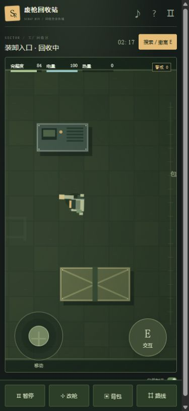

# 废枪回收站 · Scrap Run

一款适合手机竖屏玩的单人搜打撤网页小游戏。搜刮零件，自由组合子弹行为，带着战利品撤离。

纯 HTML、CSS 和 JavaScript，无第三方运行依赖，无后端。存档保存在当前浏览器的 localStorage 中。

## 试玩

下载仓库后，直接使用浏览器打开 `index.html`。也可以用 Node.js 启动本地服务：

```sh
npm start
```

然后打开 `http://127.0.0.1:4173`。静态托管时，把仓库根目录作为站点目录；GitHub 仓库地址本身不是在线游戏地址。

```sh
npm test        # 检查模块组合、库存、结算、保险、地图与页面引用
npm run export  # 生成 standalone/scrap-run.html 单文件版
```

## 操作

手机竖屏：

- 左下虚拟摇杆移动，镜头自动跟随角色。
- 默认自动瞄准和射击，右下按钮搜索补给箱或呼叫撤离。
- 底栏打开改装台、背包、路线图；这些操作会自动暂停。
- 在模块卡片上选择零件，用左箭头交换相邻模块。

电脑：

- WASD / 方向键：移动；鼠标点地：移动到指定位置。
- E：搜索 / 撤离；Tab：暂停并改枪；空格：暂停 / 继续。
- F：切换自动射击；按住鼠标右键：手动朝指针方向射击。
- 切出窗口自动暂停，返回后手动继续。

## 已实现

- 9 个工厂房间、4 类敌人、2 个撤离点。
- 3 种机匣、12 种模块、最多 6 个逻辑槽。
- 追踪、撞击触发、多重发射、弹跳、穿透、燃烧、冰冻、钻头、爆破与电弧。
- 子弹逻辑按顺序执行，触发器包住后面的组合；最多支持两层命中触发。
- 供能与散热、免费试射、局内改装、背包容量与 1 格保险。
- 搜刮、警戒增援、撤离入库、阵亡损失和材料制作。
- 积水导电、油污燃烧、薄墙与木箱破坏。
- 手机竖屏镜头、触控摇杆与弹出式改装台。

## 文件

| 文件 | 用途 |
| --- | --- |
| `index.html` | 页面与界面结构 |
| `style.css` | 桌面与手机竖屏布局 |
| `engine.js` | 模块编译、地图、库存与结算规则 |
| `game.js` | 战斗、绘制、触控、交互与存档 |
| `check.cjs` | 核心规则和页面引用检查 |
| `serve.mjs` | 本地静态预览服务 |
| `export.mjs` | 单文件网页导出 |

## 当前边界

这是可试玩的早期原型，支持单人 PVE，没有联网对战与跨设备云存档。已完成桌面浏览器和 390 × 844 竖屏视口测试；尚未覆盖所有手机浏览器和真机组合。


